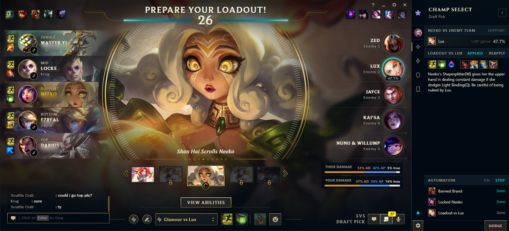
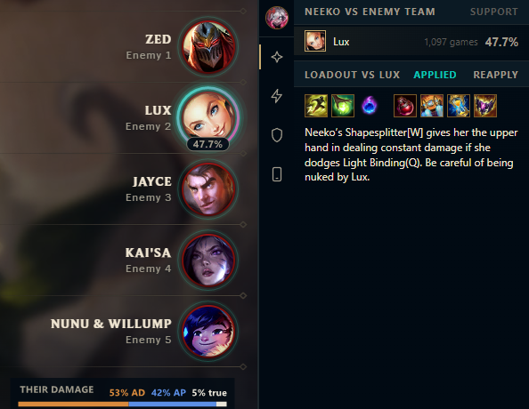
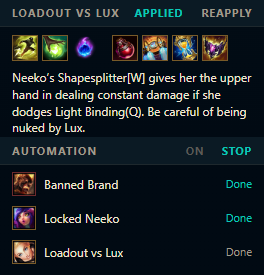
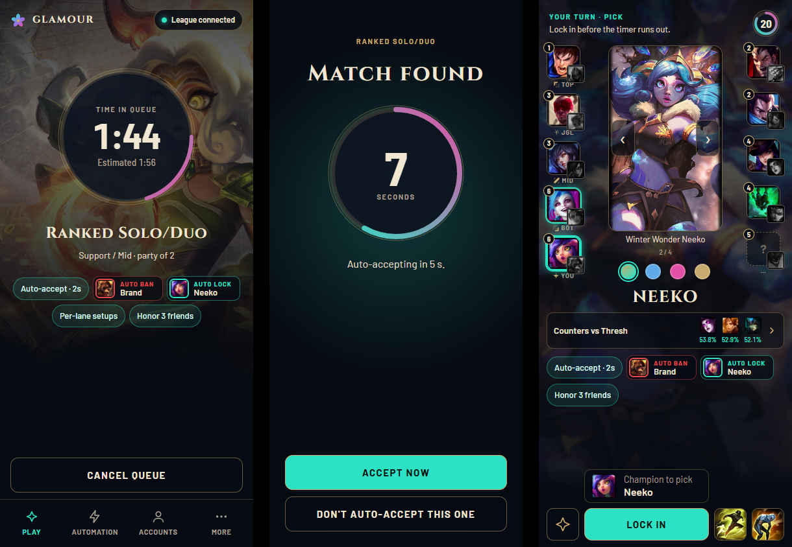

<p align="center">
  
</p>

<h1 align="center">Glamour</h1>

<p align="center">
  <b>Your League client, upgraded.</b><br>
  A companion for League of Legends: auto-accept, bans and picks, counters and runes, right beside the client.
</p>

<p align="center">
  <a href="https://github.com/Zyrecx/lol-glamour/releases/latest"></a>
  &nbsp;
  <a href="https://ko-fi.com/zyrecx"></a>
</p>

<p align="center">
  
</p>

## What it does

### Champ select help


- Counter picks against your lane opponent, from Lolalytics, limited to champions you own.
- The enemy team's damage split, and yours as your team hovers.
- A ring on the enemy you face and win rate tags on the client's cards.

### Automation


- Accept matches, instantly or at the last second.
- Ban and lock per lane, or let Best counter choose. Never touches your own hover or lock.
- Matchup loadout: runes in a separate page, item set and summoner spells for the matchup. Your own rune pages are never changed.

### Phone and accounts


- Queue and accept from your phone over your home Wi-Fi.
- Save your accounts and switch between them in one click.

### Also
- ARAM Mayhem: win rates on the bench, and tags on the augment cards (off by default).
- Skip the honor screen, or honor your friends first.

## All features

<details>
<summary>&nbsp; <b>Champ select</b></summary>

- **Counter picks:** the best picks against your lane opponent, from Lolalytics, only champions you own.
- **Counters vs the whole team:** picks ranked by win rate against every enemy picked so far.
- **Champion pool:** your champions per lane, always shown among the counters.
- **Lane guess:** who you are likely facing, with a chance per enemy; one tap sets it yourself.
- **Your champion vs your lane:** how your pick does against the enemies in your lane.
- **Damage split:** the enemy team's physical and magic damage, and your team's.
- **Duo synergy:** how well your bot lane pick fits your partner's.
- **Marks on the client:** a ring on the enemy you face and win-rate tags on the client's cards.
- **Parties:** who queued together, on both teams.
- **Dodge:** leave champ select from the panel, with a second tap to confirm.

</details>

<details>
<summary>&nbsp; <b>Automation</b></summary>

- **Auto-accept:** accept matches instantly or at the last second, with a countdown you can cancel.
- **Auto-ban:** ban a champion on your turn; skipped if a teammate hovers it.
- **Auto-lock:** lock your champion on your turn, or let Best counter choose.
- **Pre-select:** show your champion to the team before your turn.
- **Per lane:** a different ban, lock and pre-select for each lane.
- **Timing:** act at once or at the last second, with a delay and a Skip button.
- **Matchup loadout:** runes, item set and summoner spells for the matchup, applied when you lock in. Runes go in a separate page; yours are never changed.
- **Lane swaps:** accept a swap to a better lane, or ask for your lane.
- **Pick-order swaps:** move toward the pick slot you like (last, first, not first).
- **Stop and pause:** stop automation for this champ select, or pause it for a game.
- **Never overrides you:** your own hover or lock always wins.

</details>

<details>
<summary>&nbsp; <b>ARAM and Mayhem</b></summary>

- **Bench win rates:** win rates for the bench champions, on the client, the panel and your phone.
- **Mayhem win rates:** from arammayhem.com instead of u.gg's tiers (off by default).
- **Augment tags:** each offered augment's win-rate change on your champion (off by default).

</details>

<details>
<summary>&nbsp; <b>In game and after</b></summary>

- **Premades on the loading screen:** a frame and a "Duo" or "3-stack" tag on each party.
- **Parties in game:** everyone who queued together, with names and champions.
- **Auto-honor:** honor friends from your list after each game.
- **Stay after honoring:** leave the screen open for your other votes.
- **Skip the honor screen:** when no listed friend played.
- **Skip post-game screens:** close the screens you pick as soon as they appear.

</details>

<details>
<summary>&nbsp; <b>Phone</b></summary>

- **Play from your phone:** pick a mode, set your positions, queue and cancel, over your home Wi-Fi.
- **Every queue:** including queues the client hides; pin your favourites.
- **Match found:** accept or decline, or cancel an auto-accept.
- **Champ select:** pick and lock, skins and chromas, summoner spells, rune pages, counters and swaps.
- **Honor:** vote from your phone after a game.
- **Notifications:** match found, your turn and more, through Web Push or ntfy; choose which ones.
- **Pairing:** scan a QR code, or sign in with a password.
- **Installs as an app** on your home screen.

</details>

<details>
<summary>&nbsp; <b>Accounts and profile</b></summary>

- **Account switcher:** save your accounts and switch in one click, also from the tray.
- **Rank and status:** show friends a different rank or a status message of your own.
- **Profile tokens:** choose the three challenges on your profile.
- **Profile icon:** clear your profile icon.
- **Parties and invitations:** join friends' open parties, accept or decline invitations.

</details>

<details>
<summary>&nbsp; <b>Desktop app</b></summary>

- **Docked panel:** sits beside the League client, left or right; a thin bar when closed.
- **Opens in champ select:** or stays a bar until you open it.
- **Tray:** runs in the tray; starts with Windows if you like.
- **Tour:** a short setup on first start.
- **Updates:** installed when you close Glamour, a notice, or off.
- **Send a log:** a zip with names removed, to attach to an issue.

</details>

## Install and updates

1. Download `GlamourApp-win-Setup.exe` from [Releases](https://github.com/Zyrecx/lol-glamour/releases/latest).
2. Run it. No admin needed; it installs to `%LOCALAPPDATA%\GlamourApp`.
3. Glamour starts in the tray and docks beside the League client when it opens.

Settings > Updates chooses how new versions arrive: installed when you close Glamour, a notice, or Off.

## Privacy

Glamour runs on your PC and talks to the League client on your PC. It sends nothing about your account.

With **Help improve Glamour** on (Settings, on by default), it sends:

- **Errors** to Sentry: the error message, where in the code it happened, app, Windows and .NET versions. Riot IDs, names and ids are removed first. No IP stored, no user or machine name.
- **Usage counts** to Aptabase: once per start (app version, Windows version, language, whether phone access is on, how many saved accounts) and once per game (queue, which features are on, how often each one acted). No account, no install id.

Logs never leave your PC unless you press **Send a log**, which saves a zip with names and ids replaced so you can attach it to an issue.

## Is this allowed?

Glamour talks to the League client through its local API (the LCU) and reads the game's Live Client Data. For the loading-screen and augment tags it looks at a few areas of the screen. It never reads or changes game memory or game files and never injects anything into the client or the game, so Riot's block on game memory access (from October 2026) does not touch it.

It follows Riot's [developer policies](https://developer.riotgames.com/policies/general) as far as it can: it shows only what the client itself shows (no hidden names, no enemy timers), and auto-ban and auto-lock only do what you set. Best counter is the one place where Glamour picks for you.

Still, Riot does not support the LCU for third-party apps, and Glamour is not registered with or approved by Riot. The LCU is not allowed on the Korean server. Use it at your own risk.

arammayhem.com notes that Riot asks developers not to publish Mayhem augment win rates, so the augment tags and arammayhem.com's win rates are off by default. If Riot or a data source asks, the feature goes.

Glamour isn't endorsed by Riot Games and doesn't reflect the views or opinions of Riot Games or anyone officially involved in producing or managing Riot Games properties. Riot Games, and all associated properties are trademarks or registered trademarks of Riot Games, Inc.

## Build from source

Needs the .NET 10 SDK and Node 22.

```
cd web && npm ci && npm run build && cd ..
dotnet build Glamour.slnx
dotnet test Glamour.slnx
dotnet run --project src/Glamour.Desktop
```

## Credits

- **Data:** counters and win rates from [Lolalytics](https://lolalytics.com); matchup builds from [OP.GG](https://www.op.gg) through its [public endpoint](https://github.com/opgginc/opgg-mcp); Mayhem numbers from [aramkit](https://aramkit.com), [arammayhem.com](https://arammayhem.com) (CC BY 4.0) and [u.gg](https://u.gg).
- **Art:** champion, item and rank art from Riot's Data Dragon and [CommunityDragon](https://www.communitydragon.org).
- **Related projects:** augment card detection builds on [ARAM Mayhem Tracker](https://github.com/Sygnano/aram-mayhem-tracker) by Sygnano: its button image, card positions and ranking rules.
- **Fonts:** Cinzel and Barlow from [Google Fonts](https://fonts.google.com).

## License

[MIT](LICENSE)
